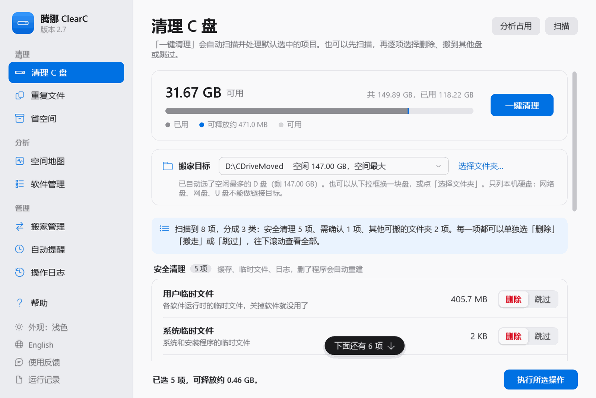
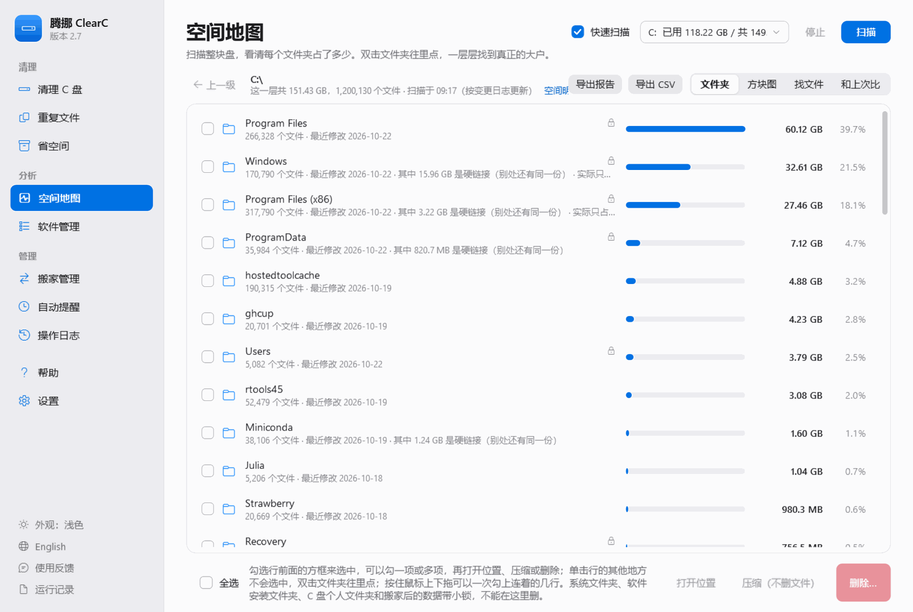
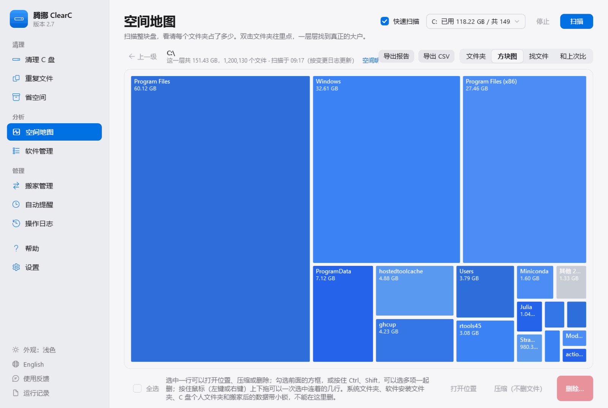
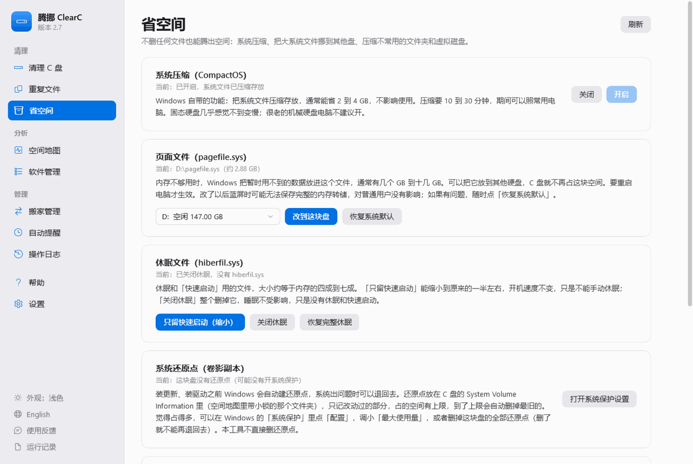
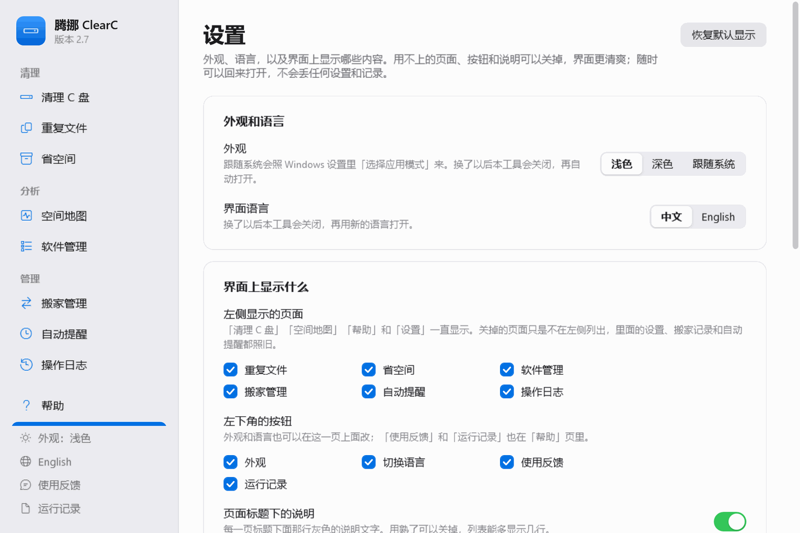
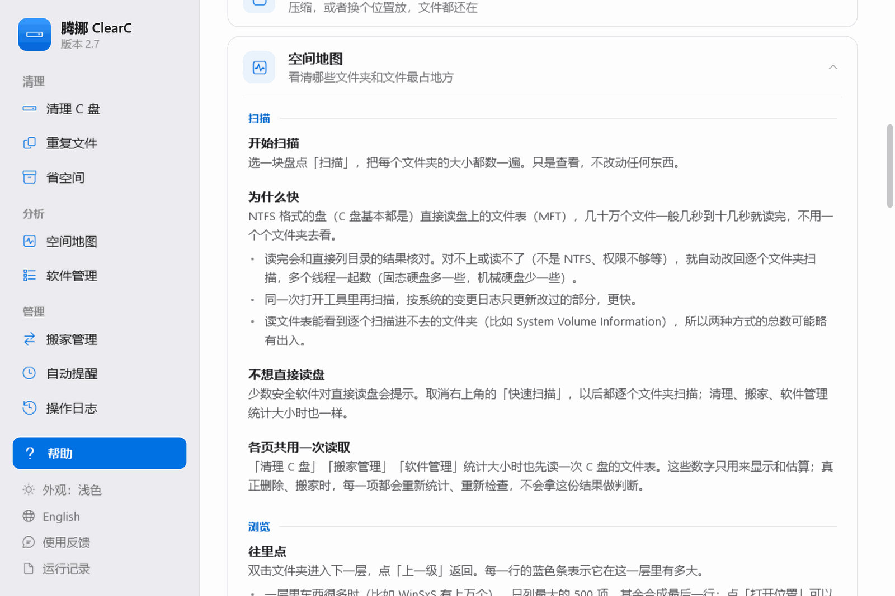
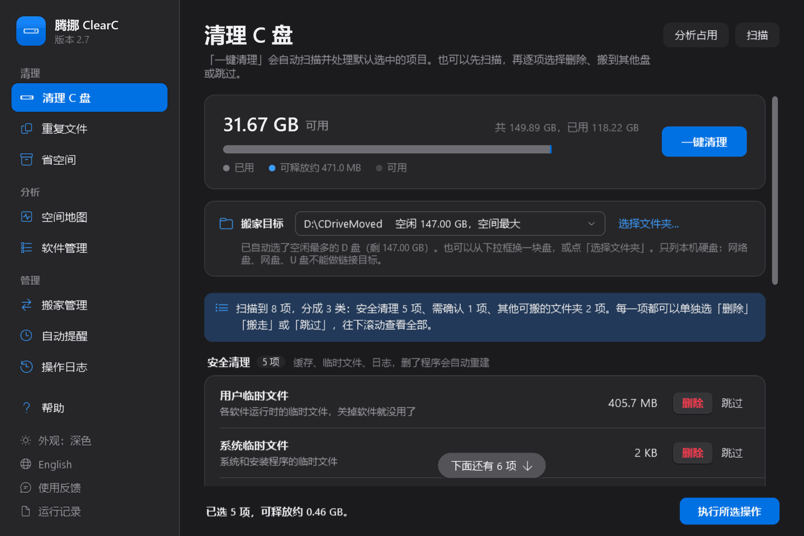
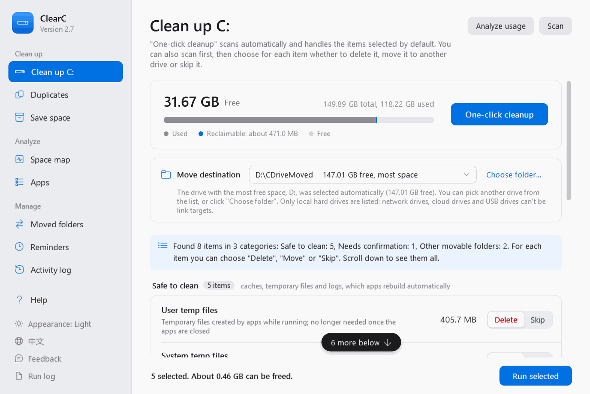
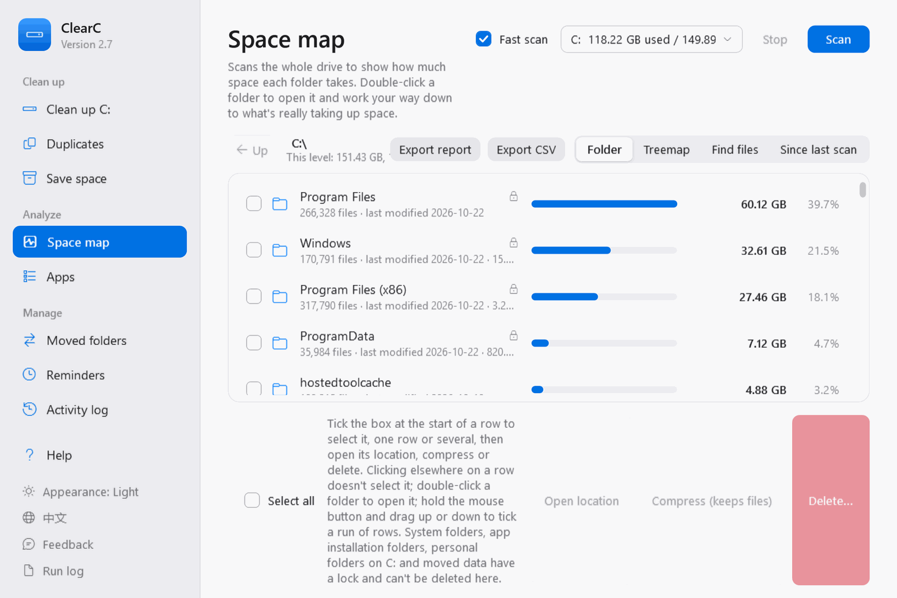
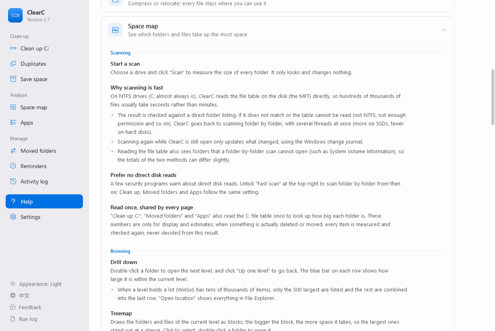

<p align="center"></p>

<h1 align="center">腾挪 ClearC</h1>

<p align="center">Windows 10 / 11 上给 C 盘腾空间的小工具（原名「C盘清理工具」）：清缓存、把聊天记录和软件搬到其他盘、找出大文件和重复文件。<br>单个 exe，双击就能用，不用安装。</p>

<p align="center">中文 · <a href="#english">English</a></p>

---

## 能做什么

| 页面 | 做什么 |
|---|---|
| **清理 C 盘** | 扫描后按类分成选项卡列出可以处理的项目（选项卡往下滚时停在顶上，换一类不用来回滚），每一项都可以选「删除」「搬到其他盘」或「跳过」，表头可以按名称、大小排序，下拉框可以只看某一种操作。缓存、临时文件、日志这类删了会自动重建的，默认选中；Windows.old、回收站、Windows Installer 孤儿安装包、驱动解压残留、失效快捷方式、事件日志这类有代价的，默认跳过。也可以「一键清理」：只删不搬；聊天记录占得多时清理页上单独一张卡片，点「搬走聊天记录」才搬。清理分四档：安全清理（默认删）、清后要重建（浏览器缓存、着色器、下载缓存这类删了要重新生成的，默认也删但单独成组、执行前单独列出）、默认不清、受保护（一律不碰）。执行前可以「看文件清单」，设置里可以让删除先进回收站；每一项删前删后的剩余空间都记在操作日志里。扫描一般几秒钟：文件夹大小从文件表里查，要问系统的几项（孤儿安装包、旧版驱动包、传递优化缓存）同时问；打开本工具后空闲时就在后台把 C 盘的文件表读好。清理项来自一张几十条的缓存目录库：Windows 自己的临时文件、更新缓存和日志，Chrome、Edge、Firefox、Brave、360、QQ 等浏览器的网页缓存，显卡着色器缓存，Steam、Epic、Adobe、Teams、Discord、Slack、VS Code、Spotify、网易云音乐等软件的缓存，pip、npm、NuGet、Go、Rust 等开发工具的下载缓存。只删缓存，不碰 Cookie、历史记录、密码和保存的数据。也可以自己加文件夹、排除文件夹。 |
| **聊天记录搬家** | 微信（新版和旧版）、QQ、企业微信、腾讯会议、飞书、钉钉，以及 Telegram、Discord、Slack、Signal、LINE、Viber、KakaoTalk、Zoom 的聊天记录和数据，整个搬到其他硬盘，C 盘原位置留一个链接，软件照常使用。软件开着时会先问你要不要替你关掉。 |
| **重复文件** | 找出内容完全相同的文件。查找条件分成四个选项卡，开始查找后自动收起，结果占满页面。NTFS 盘上找 1 MB 以上的文件时，直接从文件表列出文件，不用一个个文件夹去看。可以删掉多余的，也可以「合并为一份」（硬链接，每个位置的文件都还在，只占一份空间）。「相似照片」按 64 位指纹找看起来一样的照片（不同分辨率、重新压缩、轻微裁剪的也算），只能进回收站或归档。留法：留最新 / 最早 / C 盘以外 / 某个文件夹里的 / 路径最短的；「归档勾选的」不删，搬到一个文件夹里按原路径放。 |
| **省空间** | 左边目录选一项，右边只显示那一项。不删文件也能省：系统压缩（CompactOS）、NTFS 压缩文件夹、页面文件改到其他盘、休眠文件精简、压缩 WSL / Docker 的虚拟磁盘、把 WSL 发行版（wsl --manage --move）、模拟器和虚拟机整个搬走、OneDrive 同步文件改成「仅在线」、关掉 Windows 保留的存储、蓝屏只存小转储、临时文件夹改到其他盘、让 DISM 分析组件存储能回收多少。还能看系统还原点占了多少（只看不删，要调整打开 Windows 的「系统保护」）。 |
| **空间地图** | 扫描整块盘，一层层点进去看是哪些文件夹占了空间，也可以看成「方块图」。NTFS 格式的盘直接读盘上的文件表（MFT），几十万个文件一般几秒到十几秒就扫完；读不了时自动改回逐个文件夹扫描（也可以关掉「快速扫描」）。「找文件」按大小、多久没改过、类型、名称筛选大文件，可以多选一起删，也可以只看聊天记录里的大文件（只看不删）；「和上次比」看哪些文件夹在变大。每一行前面有复选框（像资源管理器的「项目复选框」），也可以按住鼠标左键或右键上下拖一次选中连着的几行，右键菜单里能打开、复制路径、压缩、删除。快速扫描时会注明实际占用（压缩、稀疏、只在云端的文件比文件大小占得少）和硬链接（WinSxS 里很多文件和 System32 是同一份），「空间明细」说清已用空间分成哪几块、为什么和按文件大小相加对不上。页面上方每块盘一张健康卡片：用量、健康状态，固态硬盘还有温度、磨损和通电时间，按档位标色。上方一行概览：已用 / 总量和系统与软件、个人文件、可清理缓存、其他、剩余的分段条；方块图和列表联动（点方块选中行，选中行方块描边）；「按类型」把全盘文件按扩展名分成十类；「找文件」最多 1000 个，可按大小或时间排序、按所有者筛选；「最近改动」读变更日志（USN）列出这几天新建、改写的文件最集中的文件夹；「和上次比」的快照带日期保留，可以和几天前的比，并用一句话说清已用空间多了多少、主要在哪（Docker、WSL、浏览器缓存、Windows 更新…）。后退、前进（鼠标侧键、Alt+← / Alt+→）和可以点的路径；「待删清单」在不同文件夹里挑好要删的再一起删，下面一直写着删完这块盘大约剩多少，删完写明实际多出了多少；「值得一看」列出名字一看就是缓存、依赖包、构建产物、虚拟环境的大文件夹；方块图按文件夹装的东西上色，缓存带斜线。列表可以导出成 CSV，整块盘的情况可以导出成网页报告（在浏览器里能存成 PDF）。 |
| **软件管理** | 已装软件按占用大小排列。可以卸载，卸载后检查残留文件夹；装在 C 盘的还可以整个搬到其他盘，不用重装。「检查新版本」用 Windows 自带的 winget 查哪些软件有新版本，点「升级」在终端里升级。另外四个视图：开机启动（和任务管理器一样的来源）、第三方的计划任务、第三方的右键菜单扩展（都可以禁用和重新启用，不删任何东西），以及已卸载软件可能留下的残留文件夹（只是猜测，看过再移到回收站）。每一行都能勾选（或按住左键拖选），一次卸载几个软件（依次打开各自的卸载程序，一个走完再开下一个）、一次禁用或启用几项、一次把几个残留移到回收站，都先确认一次。 |
| **系统健康** | 标题旁一排选项卡，点哪一项只显示哪一项；蓝屏和崩溃再分三个小选项卡，常见问题修复左边选问题、右边看修法。**硬件**：CPU（负载、频率、性能计数器判断降频、ACPI 温度）、内存（已用、提交、硬错误、WHEA 内存错误）、每块盘（SMART 健康、温度、磨损、读错误）、电池、显卡、Windows（版本、开机时长、等待重启、最近更新、有问题的设备、时钟是否被往回调），读不到的明说读不到。**开机用时**和拖慢开机的程序。**蓝屏和崩溃**：自己解析 Minidump（错误码、参数、读盘失败的状态码、出事的进程、可能的驱动、栈上的驱动），每次蓝屏一句话说明；「诊断结论」把几次蓝屏、事件日志、硬盘健康、时钟和系统版本放在一起看（比如读盘失败 + 系统进程反复退出 = 系统盘掉线），每条下面有「按建议处理」（本工具能做的几步一次做完，先确认、能撤销）和「需要你自己做的」（备份、更新 BIOS 和驱动、厂商硬件检测……，写明这台电脑的版本有多旧），还有按服务编号直达的厂商驱动下载页；可以复制报告、导出诊断包（转储、30 天日志、systeminfo、驱动列表）。**常见问题修复**：按问题列出论坛里最常用的修法（蓝屏、掉盘、系统文件、Windows 更新、网络、时间、睡眠唤醒、声音、图标和商店、开机慢），全是 Windows 自带命令，在看得见的终端里跑，会改动的先确认，能撤销的先留底，不删文件、不结束程序。**活动监控**（点列名按 CPU、内存、写入速度、写入量排序）和 **Windows 事件**。打开本工具后在后台先把这些读好，点进来不用等；中途插拔硬盘会自动刷新。 |
| **搬家管理** | 「可以搬的」自动列出 C 盘上还能搬走的聊天记录、软件和其他大文件夹，勾选后一次搬好几项；不适合搬的软件单独列出并写明原因。左边目录一次只看一组。「已经搬走的」显示每个搬走的文件夹现在的状态，可以搬回 C 盘、修复断掉的链接、删掉没搬完留下的多余副本。 |
| **自动提醒** | C 盘剩余空间低于设定值、或者可以清理的缓存超过设定值时在右下角提醒（每次登录电脑后和每天中午各检查一次）；定期自动清一次缓存，每周某一天或每天。两项默认关闭，由 Windows 任务计划运行，不用一直开着本工具。 |
| **操作日志** | 每一次删除、搬运、合并、压缩、卸载和系统设置改动都记成 txt，可以按类别和时间查看。默认保存半年，可以改。 |
| **设置** | 左边目录分「常用」「界面」「清理和扫描」，点哪一项只显示哪一项。**使用模式**：普通用户、工程师、开发者和 IT 三档，决定界面上有多少东西（第一次打开时问一句，随时可以换，不丢设置）。外观、语言，以及界面上显示什么：用不上的页面、左下角的按钮、页面说明、空间地图的复选框和各列都可以关掉；快速扫描的开关；查重复文件时让着其他程序（Windows 的后台模式，磁盘和内存都用低优先级）；清理列表：删除时先放进回收站、自己加要清理的文件夹、排除不想碰的文件夹。 |

**三种使用模式**，功能一级比一级多，换模式不丢任何设置和记录：

| 模式 | 给谁 | 有什么 |
|---|---|---|
| **普通用户** | 只想把 C 盘清干净 | 清理 C 盘、省空间、空间地图、软件管理、系统健康（硬件、蓝屏和崩溃、常见问题修复）、帮助。清理列表里只有常见的缓存和临时文件，删了软件会自动重建；有代价的项目仍然默认跳过。 |
| **工程师** | 自己维护电脑的人 | 再加上重复文件、搬家管理、自动提醒、操作日志；空间地图的找文件、和上次比、最近改动、导出、压缩；省空间的页面文件、还原点、压缩文件夹、虚拟磁盘、合并重复文件；软件管理的开机启动、残留文件夹、检查新版本、搬到其他盘；系统健康的开机用时、活动监控和改动较大的几步修复（重置网络、重置更新组件、开机检查 C 盘、关闭硬盘省电、关闭快速启动）；清理列表里多出开发工具的缓存和驱动残留。 |
| **开发者和 IT** | 开发者、运维、IT 支持 | 全部功能。再加上计划任务、右键菜单、保留的存储、组件存储分析、蓝屏转储、临时文件夹位置、自定义清理列表和排除、快速扫描开关、空间明细、检查扫描功能、运行记录、修复系统文件、Windows 事件汇总，以及 Installer 孤儿安装包、事件日志、旧版驱动包、NuGet / Gradle / Maven / JetBrains 缓存这类项目。 |

界面支持**中文和英文**、**浅色和深色**，在「设置」里或左侧栏底部的「English / 中文」「外观」切换。「帮助」页里可以**检查新版本**（只在点的时候联网），以及**检查扫描功能**：在你的电脑上核对快速扫描是否准确，结果可以发给开发者。

## 界面截图

<p align="center"></p>

<table>
  <tr>
    <td width="50%"><br><sub>空间地图：一层层看是哪些文件夹占了空间，每行前面有复选框</sub></td>
    <td width="50%"><br><sub>方块图：方块越大，占的空间越多</sub></td>
  </tr>
  <tr>
    <td><br><sub>省空间：系统压缩、页面文件、休眠文件、还原点，不删文件</sub></td>
    <td><br><sub>设置：外观、语言，以及界面上显示什么</sub></td>
  </tr>
  <tr>
    <td><br><sub>帮助：左边目录，点哪一项右边看哪一项</sub></td>
    <td><br><sub>深色模式</sub></td>
  </tr>
</table>

截图是 GitHub 上的自动测试机拍的（界面自测时顺便扫一遍那台机器的 C 盘，只统计不删），所以文件夹和大小是测试机上的，和普通电脑不太一样。

## 安全原则

- **个人文件夹里的东西一律不删**：桌面、文档、下载、图片、视频、音乐、收藏夹、OneDrive，包括这台电脑上其他账户的个人文件夹和「公用」文件夹。即使误选也会自动跳过。
- **删除前必须确认**：每次删除都要先勾选「我已确认这些资料不再需要」才能点删除。
- **系统位置不让删**：Windows 文件夹、软件的安装文件夹（请到「软件管理」卸载）、保存密码和证书的位置、软件安装包缓存、搬家后的数据，都会被挡住并说明原因。
- **搬家先核对再删**：复制到目标盘后，两边的文件个数和大小核对一致，才把原位置换成链接、删除 C 盘上的那份。核对不过、文件被占用，原文件夹都原样不动。
- **可以中途取消**：耗时的操作随时能点「取消」，停在安全的地方。搬家时还在复制就取消，C 盘上的原文件夹不动；正在换成链接这类不能停在一半的步骤，会做完这一步再停。
- **有记录可查**：所有改动都写进操作日志。
- **放进回收站就是放进回收站**：网络位置、U 盘、回收站被关掉、文件比回收站还大时，Windows 会改成永久删除；本工具事先判断，这种情况不删并说明原因。
- **确认的是什么就做什么**：执行时逐项核对是不是扫描时列出的那一项；扫描后改了清理列表，要重新扫描。
- **不跟进链接**：删除时遇到目录联接、符号链接只拆链接本身，指向的文件夹一个文件都不动；OneDrive 同步文件夹里的东西不搬。

每条执行路径可能怎么丢数据、现在靠什么挡住、哪些问题修了哪些推迟、每次改代码自动跑哪些安全测试，见 [docs/SAFETY.md](docs/SAFETY.md)。

## 搬家是怎么工作的

软件去哪里读写数据，是软件自己决定的，大多数没法改（比如 `AppData\Roaming\Tencent`）。所以搬家时，工具把整个文件夹复制到其他盘（默认放在空闲最多那块盘的 `CDriveMoved` 文件夹里），核对一致后，在 C 盘原位置放一个 **目录链接（junction）**，再删掉 C 盘上的原文件夹。

链接几乎不占空间。软件打开原来的路径时，Windows 自动转到目标盘上读写，软件察觉不到任何变化，不用改设置，也不用重装。

需要注意：目标盘要一直接着；请不要删除、改名或移动 `CDriveMoved` 文件夹。在「搬家管理」里随时可以把它们搬回 C 盘。

## 下载和使用

1. 到 [Releases](../../releases) 下载最新的 `ClearC-vX.X.exe`（就是腾挪 ClearC，用英文文件名是因为 GitHub 不支持中文的下载文件名）。
2. 放到一个固定的位置（比如 `D:\工具\`），双击运行。需要管理员权限，会弹出 UAC 确认。
3. 第一次打开会显示安全风险提示，同意后才能使用。左侧「帮助」里有完整的使用说明。

系统要求：Windows 10 或 11。用的是系统自带的 Windows PowerShell 5.1 和 .NET Framework 4.8，不需要另装任何东西。

exe 暂时没有代码签名，Windows SmartScreen 可能提示「Windows 已保护你的电脑」，点「更多信息」→「仍要运行」即可。不放心的话可以按下面的方法自己从源码构建。

## 从源码运行或构建

整个程序就是一个 PowerShell 脚本 `src/CleanC-UI.ps1`，exe 只是把它包起来。这个脚本由 `src/parts/` 下按功能分开的文件拼成（见 [src/parts/README.md](src/parts/README.md)）：改代码时改 `src/parts/` 里的文件，再运行 `build\merge.ps1`。

**直接运行源码**：双击 `src/run-from-source.bat`（会请求管理员权限）。功能和 exe 一样，只是自动提醒、每周清理这类定时任务只有 exe 版本支持。

**在 Windows 上构建 exe**（只用系统自带的 C# 编译器，不需要 Visual Studio）：

```powershell
powershell -NoProfile -ExecutionPolicy Bypass -File build\build.ps1
```

生成的 exe 在 `out\` 里。在 Linux / macOS 上可以用 PowerShell 7 运行 `build/build-roslyn.ps1`，准备步骤写在文件开头。

### 代码结构

```
src/parts/               源码，按功能分开（拼起来就是 src/CleanC-UI.ps1）
  ├─ cs/                   C# 部分：重复文件查找、批量读目录和多线程统计、读取 NTFS 文件表（MFT）和变更日志、空间地图、深色配色、列表的行
  ├─ engine/Engine.ps1     清理、搬家、删除保护、日志、自检等核心逻辑；界面线程和每个后台任务共用
  │                        清理项在里面的缓存目录库 $script:cacheLib 里：一行一条「名称 | 路径 | 说明 | 选项」，加条目改这里，英文写进 i18n/en.tsv
  ├─ i18n/en.tsv           英文界面的翻译表
  ├─ ui/                   WPF 界面（main.xaml、英文帮助页）和各页面的界面逻辑
  └─ glue/                 把各部分接起来：管理员权限、加载 C# 类型、定时任务模式（/check、/autoclean、/selftest）
src/CleanC-UI.ps1        拼好的整个程序（直接运行源码、构建 exe 都用它）
src/run-from-source.bat  不构建、直接运行源码
build/merge.ps1          把 src/parts/ 拼成 src/CleanC-UI.ps1（-Check 只检查是不是最新的）
build/launcher.cs        exe 启动器：把脚本作为内嵌资源，放进本进程里的 PowerShell 5.1 运行
build/app.manifest       要求管理员权限、长路径支持
build/build.ps1          Windows 上构建 exe（先自动拼一次；设置了证书就顺便签名）
build/build-roslyn.ps1   其他系统上构建 exe
tests/                   测试，见下面
```

### 测试

| 测试 | 在哪跑 | 怎么跑 |
|---|---|---|
| 语法、C# 编译、XAML、控件名、翻译 | 任何装了 PowerShell 的系统 | `pwsh tests/Checks.ps1` |
| 核心逻辑（统计大小、查找、树上查大小、深色配色等） | Windows PowerShell 5.1 或 PowerShell 7 | `pwsh tests/Engine.Tests.ps1` |
| 直接读文件表、按改动增量更新 | Linux，root，装 ntfs-3g 和 PowerShell 7 | `sudo bash tests/ntfs/run.sh`：用 mkntfs 和 ntfs-3g 做出真的 NTFS 镜像（硬链接、稀疏文件、碎片、备用数据流、很深的路径、各种簇大小），和挂载后逐个文件夹数出来的结果对比。ntfs-3g 建的符号链接是普通文件，和 Windows 不同，所以允许差几处 |
| 深色模式的对比度 | 任何装了 PowerShell 和 Python 的系统 | `bash tests/theme/run.sh`：算每段文字和底色的对比度（近似） |
| 在真的 Windows 上核对快速扫描 | Windows | 程序里「帮助」→「检查扫描功能」；或者 `ClearC.exe /selftest`，结果在 `%LOCALAPPDATA%\CleanC\selftest.txt`（设置环境变量 `CLEANC_REPORT` 可以改位置，`CLEANC_QUIET=1` 不弹提示），退出码是不通过的项数。也核对实际占用（稀疏、NTFS 压缩、系统压缩、硬链接）和 Windows 自己报的是否一致 |
| 界面功能 | Windows | `ClearC.exe /uitest`：打开窗口（放在屏幕外），把各页、设置开关、项目复选框、右键拖选、右键菜单、空间明细点一遍，对话框都当作点了取消，做完自己关掉；结果在 `%LOCALAPPDATA%\CleanC\uitest.txt`（`CLEANC_REPORT` 可以改），退出码是不通过的项数。测完设置原样放回。设置 `CLEANC_SHOTS=1` 时还会真的扫一遍 C 盘（只统计不删），把几页界面存成 PNG 放在报告旁边；GitHub 上的自动测试用英文浅色、中文浅色、中文深色各跑一遍，README 里的截图就是这样来的 |

### 代码签名

exe 签了名，SmartScreen 的提示会少很多（签名的发布者信誉要随着下载量慢慢积累，刚签的版本一开始可能还会提示）。`build\build.ps1` 已经支持签名：设置环境变量 `CLEARC_SIGN_PFX`（.pfx 证书）和 `CLEARC_SIGN_PASSWORD`，或者 `CLEARC_SIGN_THUMBPRINT`（装在「当前用户 → 个人」里的证书），构建完会用 Windows SDK 的 signtool 签名并加时间戳。证书可以这样拿：

- **SignPath Foundation**（免费，给开源项目）：在 [signpath.org](https://signpath.org/) 申请。要求包括 OSI 认可的开源许可证（本项目是 MIT）、exe 由公开的自动构建（比如 GitHub Actions）从源码生成、每次签名都由维护者手动批准、项目主页写明代码签名政策。
- **Azure Artifact Signing**（原 Trusted Signing，每月约 10 美元）：目前个人开发者只限美国和加拿大，机构限美国、加拿大、欧盟和英国。
- 也可以向证书机构买 OV 代码签名证书。

### 国内下载镜像

GitHub 在国内下载慢的话，可以在 [Gitee](https://gitee.com/) 建一个同名仓库做镜像：Gitee 的「从 GitHub 导入仓库」可以定时同步代码；发版时把 exe 也上传到 Gitee 仓库的「发行版」里，再把下载地址补到这里。

### 程序在电脑上留下的东西

- `%LOCALAPPDATA%\CleanC\`：设置（settings.txt）、C 盘空间记录（history.txt）、操作日志、空间地图快照。
- 各盘的 `CDriveMoved\`：搬到其他盘的数据。
- 任务计划程序里的 `CleanC` 文件夹：只在打开自动提醒或每周清理时才会创建，关掉开关就删除。

## 安全风险提示

本工具会按你的选择删除或搬移电脑上的文件。删除的文件可能无法恢复，存在资料丢失的风险。每次删除前，请确认这些资料确实不再需要、删除不会给你带来损失；重要资料请先备份。

**因使用本工具造成的资料丢失或其他损失，责任由使用者自行承担，开发者不承担责任。**

## 反馈

- 在本仓库提 [Issue](https://github.com/Xuanqiyun/ClearC/issues)，最好附上截图，以及程序里「帮助」→「复制诊断信息」的内容；扫描结果不对的话，附上「检查扫描功能」的结果。程序里「帮助」→「使用反馈」也有打开项目主页和提交问题的按钮。

## 许可证

[MIT](LICENSE)

---

<a id="english"></a>

## English

ClearC (Chinese name 腾挪, "make room") frees up space on drive C: on Windows 10 / 11. It is a single exe that needs no installation and runs on the PowerShell 5.1 and .NET Framework 4.8 that ship with Windows.

- **Clean up C:** scans in seconds (folder sizes come from the file table, which is read in the background while ClearC is idle, and the slow questions to Windows are asked in parallel) and lists, in group tabs that stay at the top while you scroll, what can be removed (caches, temp files, update leftovers) and what has a cost (Windows.old, Recycle Bin, orphaned Windows Installer packages), each with Delete / Move / Skip. The items come from a cache library with dozens of entries: Windows' own temp files, update cache and logs; the web cache of Chrome, Edge, Firefox, Brave, 360, QQ and other browsers; shader caches; the caches of Steam, Epic, Adobe, Teams, Discord, Slack, VS Code, Spotify and more; and the download caches of pip, npm, NuGet, Go and Rust. Only caches are deleted, never cookies, history, passwords or saved data. You can add your own folders and exclude folders. Every list in ClearC sorts by clicking a column name, and the cleanup list can be filtered by action.
- **Move chat history and apps to another drive.** WeChat, QQ, WeCom, Tencent Meeting, Feishu, DingTalk, Telegram, Discord, Slack, Signal, LINE, Viber, KakaoTalk and Zoom data, as well as installed apps, are copied to another drive, verified, and replaced by a directory link, so the software keeps working unchanged.
- **Duplicates, Save space, Space map, System health, Apps, Moved folders, Reminders, Activity log, Settings.** Find duplicate files or merge them into hard links. Use CompactOS, NTFS folder compression, page-file and hibernation settings, WSL / Docker disk compaction, move WSL distributions, make OneDrive files online-only, turn off reserved storage, keep crash dumps small, move the temp folder and let DISM analyze the component store. The "Moved folders" page lists everything on C: that can still be moved and moves several items at once. Browse folder sizes as a list or treemap (NTFS drives are read straight from the file table, the MFT, so even large drives take seconds; "Fast scan" can be turned off), look at the large files inside chat data (view only), find large files by size, age, type and name and delete several at once (item check boxes like File Explorer's, left- or right-button drag to select a run of rows, and a right-click menu), see size on disk and hard links with the fast scan plus a "Space breakdown" of the used space, check how much restore points take, export an HTML report, see which folders grew since the last scan, export lists to CSV, uninstall apps and clean leftovers, check for updates with winget, disable startup items, third-party scheduled tasks and context menu extensions, find leftover folders of uninstalled apps (tick several or drag over rows to uninstall one after another, disable or enable, or recycle leftovers together), see disk health cards, move folders back, and get low-space and junk-size reminders. Every change is logged.
- **System health** has one tab per section: hardware cards (CPU, memory, drives with SMART, battery, GPU, Windows), boot time and the programs that slow it down, blue screens and crashes (ClearC parses minidumps itself: bug check, parameters, disk-read status codes, the process involved, the probable driver, drivers on the stack, each explained in one line, plus a combined diagnosis with fix buttons, a copyable report and a diagnostics-package export), common fixes (forum-standard repairs built from Windows commands, run in a visible terminal, asking first and saving what they change so it can be undone), an activity monitor and a Windows event summary. **Space map** adds a drive overview, treemap-list linking, file types, recent changes from the USN journal and growth attribution ("used space grew 18 GB: Docker 12 GB, browser caches 3.5 GB…"), back / forward with a clickable path, a delete list that shows the projected free space, "Worth a look" for caches, packages and build output, and treemap colours by kind. **Duplicates** adds similar photos (64-bit dHash), more keep rules and archiving. **Cleanup** has four tiers (safe, careful, needs confirmation, protected), a file list before deleting and an optional Recycle-Bin-first mode.
- **Safety rules.** Personal folders (Desktop, Documents, Downloads…) are never deleted, every deletion needs an explicit confirmation, and system locations are blocked. Long operations can be cancelled at any time and stop at a safe point. "Move to Recycle Bin" never silently becomes a permanent delete, links are never followed, and every step is checked against what you confirmed. The data-safety audit, the defect list and the safety tests that run on every push are in [docs/SAFETY.md](docs/SAFETY.md) (Chinese).

Three **modes** decide how much the window shows: **Home user** (Clean up C:, Save space, Space map, Apps, System health, Help; only everyday caches in the cleanup list), **Engineer** (adds Duplicates, Moves, Reminders, the log and the advanced features on each page) and **Developer and IT** (everything). ClearC asks once on first start; change it at the top of Settings at any time without losing anything. The interface is available in English and Chinese, light and dark. Switch on the "Settings" page or with "English / 中文" and "Appearance" at the bottom of the sidebar; "Settings" also hides pages, buttons, descriptions and space-map columns you don't use; the first launch follows the Windows display language. The Help page has a contents list on the left like Settings. It can check for updates (only when you click it) and run "Check scanning", which verifies the fast scan on your PC and produces a report you can send to the developer (also `ClearC.exe /selftest`; `ClearC.exe /uitest` clicks through the interface for automated testing).

<table>
  <tr>
    <td width="33%"><br><sub>Clean up C:</sub></td>
    <td width="33%"><br><sub>Space map</sub></td>
    <td width="33%"><br><sub>Help</sub></td>
  </tr>
</table>

The screenshots are taken by the automated UI test on a GitHub test machine, so the folders and sizes are that machine's.

Developers: the source is split by function under `src/parts/` and merged into `src/CleanC-UI.ps1` by `build/merge.ps1`; tests are in `tests/` (checks, engine tests, real NTFS image tests on Linux, dark-mode contrast). `build/build.ps1` signs the exe when a certificate is configured.

Download the latest `ClearC-vX.X.exe` from [Releases](../../releases). The exe is not code-signed, so SmartScreen may warn; choose "More info → Run anyway", or build it yourself with `build\build.ps1`.

**Disclaimer:** deleting files can lose data. Back up anything important. You use ClearC at your own risk, and the developer accepts no liability for any loss.

